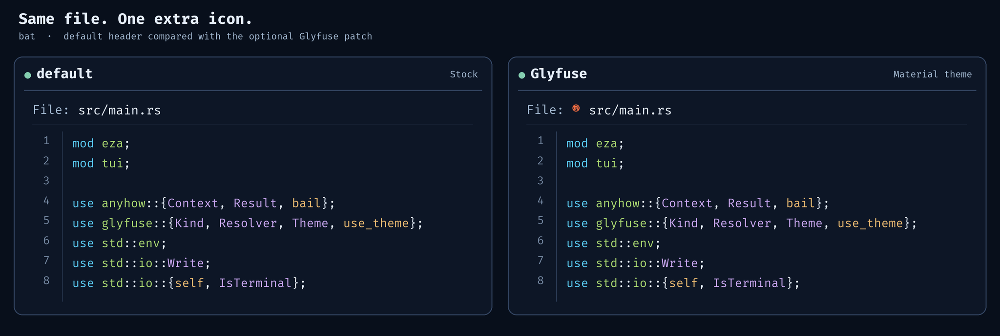

# Glyfuse

**The same icons and colors across your terminal applications.** Glyfuse makes files and folders look consistent wherever you encounter them. Use one theme with tools such as eza and a patched version of `bat`.

## Preview

### [eza](https://github.com/eza-community/eza) · [Glyfuse theme exporter](integrations/glyfuse-eza/README.md)


*Illustrative comparison of `eza`'s stock icons and Glyfuse's generated Material icon theme. Icons and their colors change; eza still controls filename styling.*

### [bat](https://github.com/sharkdp/bat) · [Glyfuse patch](integrations/glyfuse-bat/README.md)



*Illustrative comparison of `bat` with and without the optional Glyfuse patch. The patch adds a colored icon before the header filename; the rest of bat's output is unchanged.*

## Why Glyfuse?

Terminal applications often ship their own file-icon mappings. The same `README.md`, `src/` folder, or `.rs` file can end up with a different symbol and color in every tool. Glyfuse provides **one configurable resolver** and a shared theme snapshot, so a file keeps the **same icon and color in different terminal applications**.

- **Consistent icons:** one theme for files, folders, compound extensions, and paths.
- **Works without a running service:** `glyfuse theme use` writes a resolved JSON snapshot; integrations load it without invoking Glyfuse.
- **Easy to customize:** inherit the bundled Material-inspired theme and override just the rules you need.
- **Inspectable:** explore icon associations with the interactive terminal inspector.

Glyfuse is a Rust library and CLI, **not** a font installer or SVG renderer. The bundled icons use approximate [Nerd Font](https://www.nerdfonts.com/) glyphs. Choose a compatible terminal font, or use `--ascii` for plain-text CLI output.

## Quick start

Requires a recent stable Rust toolchain and Cargo. From a clone of this repository:

```sh
cargo install --path .
glyfuse theme use material
glyfuse resolve README.md --file
glyfuse resolve src/ --folder --json
glyfuse inspect --tui
```

`theme use` creates a **shared `active.json` theme snapshot**. [Build the optional bat patch](integrations/glyfuse-bat/README.md) and set `BAT_GLYFUSE=1` to make patched bat read that snapshot. For stock eza, run `glyfuse export eza --output PATH_TO_EZA_CONFIG/theme.yml` to generate its icon configuration.

## Feature status

- **Implemented:** Rust library, CLI `theme list/use/show`, `resolve`, text and interactive TUI `inspect`; versioned themes with inheritance, overrides, path globs, and fallbacks.
- **Implemented:** bundled 3,550 Material Icon Theme-derived associations (963 folders, 1,148 filenames, 1,439 extensions). Associations and sampled SVG colors come from upstream; Unicode glyphs are approximations.
- **Implemented separately:** a source patch for bat's filename header icon. Stock bat is unchanged.
- **Implemented:** eza `theme.yml` icon exporter; works with stock eza and requires re-exporting after Glyfuse theme changes.
- **Planned only:** Neovim tree/explorer integrations, SVG display, font probing, automatic synchronization, package release.

## CLI reference

For development and additional commands:

```sh
cargo test --all-targets
cargo build --release
cargo install --path .
glyfuse --help
glyfuse theme list
glyfuse theme show
glyfuse theme use material
glyfuse theme use ./my-theme.json
glyfuse resolve src --folder --json
glyfuse resolve README.md --file
glyfuse resolve archive.tar.gz --json
glyfuse resolve unknown.xyz --ascii --no-color
glyfuse inspect --ascii
glyfuse inspect --tui
glyfuse export eza --output ./theme.yml
glyfuse --theme material resolve src --folder --json
```

Built-in Material data is embedded in the executable. An existing directory or trailing slash implies folder matching; `--folder` / `--file` overrides detection. `--expanded` selects expanded folder icons; `--json` emits only an icon object. Normal interactive-terminal output colors the glyph and leaves path text uncolored.

In `inspect --tui`, type a path for a live matching preview: `src/` is a folder; `src/a.exe` is a file. A trailing `/` or `\` selects folder matching automatically. `Tab` switches keyboard focus between the editable path and the complete association list. With the list focused, arrows/Page Up/Down/Home/End navigate; the mouse wheel and draggable scrollbar scroll through all rules. `Enter` or clicking an association copies its sample path to the input. In the path input, Left/Right/Home/End, Backspace, and Delete edit the text. `Ctrl+E` toggles expanded folder icons; `Esc` or `Ctrl+C` exits. `--ascii` replaces glyph display with generic ASCII markers.

## Theme JSON format (v1)

UTF-8 JSON. Glyphs contain printable Unicode; colors are `#RRGGBB`. Custom override example:

```json
{
  "format": 1,
  "name": "My theme",
  "inherits": "material",
  "rules": [
    {"kind":"folder", "pattern":"assets", "icon":{"glyph":"★","color":"#55CC99"}, "expanded":{"glyph":"☆","color":"#55CC99"}},
    {"kind":"file", "pattern":"Cargo.toml", "icon":{"glyph":"R","color":"#FF7043"}},
    {"kind":"extension", "pattern":"test.ts", "icon":{"glyph":"T","color":"#3178C6"}},
    {"kind":"path", "pattern":"**/generated/*.rs", "icon":{"glyph":"G","color":"#AAAAAA"}}
  ]
}
```

A base theme without `inherits` must add a `fallbacks` object like the following **field value**:

```json
{
  "file": {"glyph":"?", "color":"#B0BEC5"},
  "folder": {"glyph":"+", "color":"#90A4AE"},
  "folder_expanded": {"glyph":"-", "color":"#90A4AE"}
}
```

`folder_expanded` is optional. Rules may provide `source_icon` as descriptive attribution metadata. Resolution priority: **path glob > exact filename/folder > longest compound extension > fallback**; later duplicates take precedence. Matching is case-insensitive; backslashes are normalized; extension patterns omit the leading dot (`tar.gz`). Path globs use `globset` syntax and are matched against the supplied path. `inherits` accepts `material` or a file path; relative parent paths resolve against the child JSON file. Cycles, malformed colors, invalid glob expressions, and control characters in glyphs are rejected.

`theme use` flattens inheritance and saves a fully resolved shared `active.json`:

| OS | Location |
| --- | --- |
| Windows | `%APPDATA%\glyfuse\active.json` |
| Linux/Unix | `${XDG_CONFIG_HOME:-$HOME/.config}/glyfuse/active.json` |

Override the parent directory with `GLYFUSE_HOME`. `GLYFUSE_THEME=/absolute/path/to/flattened.json` selects a specific snapshot; the CLI also accepts `GLYFUSE_THEME=material`, but standalone integrations expect an actual JSON path. Prefer `glyfuse theme use material` to activate a shared preset. Restart integrations after changes to the snapshot.

## Integrations

| Application | Status | Enablement | Glyfuse runtime dependency? |
| --- | --- | --- | --- |
| Glyfuse CLI/library | Implemented | Built in | Native component |
| **bat** | **Patched source only** | Apply [`integrations/glyfuse-bat/patches/0001-glyfuse-bat-header-icon.patch`](integrations/glyfuse-bat/patches/0001-glyfuse-bat-header-icon.patch), rebuild, set `BAT_GLYFUSE=1` | **No**; patched bat reads JSON independently |
| **eza** | **Stock eza, generated config** | Export `theme.yml` using [`glyfuse export eza`](integrations/glyfuse-eza/README.md), then run eza with `--icons=always` | **No**; eza reads YAML independently |
| Neovim file trees and other terminal tools | Future | No integration shipped | TBD |

The modified bat colors **only the icon prefix before the header filename**. The filename itself is plain/uncolored; body syntax highlighting stays upstream. If disabled or no valid snapshot is found, the usual bat header remains. **Unmodified bat does not support Glyfuse.** See the [bat patch guide](integrations/glyfuse-bat/README.md) for build, patch, verification, and update steps.

The eza exporter produces a standard `theme.yml` containing file and folder name and simple-extension icon overrides. It preserves eza's filename colors and does not need a patched binary. Re-run the export when the Glyfuse theme changes. See the [eza setup guide](integrations/glyfuse-eza/README.md) for platform-specific paths and format limitations.

## Material theme provenance

The [bundled Material preset](themes/material.json) adapts definitions and color values from [Material Icon Theme](https://github.com/material-extensions/vscode-material-icon-theme), copyright © 2025 Material Extensions, licensed MIT, pinned at commit `1a9d4b3d478d7fd1c49a86ea371ec6a8b505b097`. SVG files were used for color sampling during import, **never shipped or rendered**; many associations use generic approximated symbols. Some sampled colors can differ from upstream's composited SVG appearance. See [third-party notices](THIRD_PARTY_LICENSES.md).

## 📜 License

Glyfuse is licensed under the [MIT License](LICENSE). The Material-derived theme includes third-party material covered by the [third-party notices](THIRD_PARTY_LICENSES.md). The separate upstream `bat` submodule is licensed **MIT OR Apache-2.0** and retains its own license files.

No prebuilt Glyfuse or patched-bat binaries are published here; build them from source.
