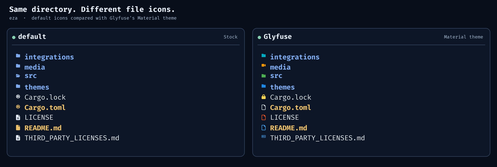

# Glyfuse × eza — generated icon theme

Glyfuse exports the supported icons and RGB colors from the active theme into
[eza](https://github.com/eza-community/eza)'s standard `theme.yml`. **No eza patch
or Glyfuse runtime dependency is needed.** eza reads the generated file itself.



## Setup

Install eza and Glyfuse, then select the shared Glyfuse theme:

```sh
glyfuse theme use material
```

On Linux/macOS:

```sh
mkdir -p "${XDG_CONFIG_HOME:-$HOME/.config}/eza"
glyfuse export eza --output "${XDG_CONFIG_HOME:-$HOME/.config}/eza/theme.yml"
eza --icons=always --color=always
```

In PowerShell (Windows):

```powershell
$ezaDir = Join-Path $env:APPDATA 'eza'
New-Item -ItemType Directory -Force -Path $ezaDir | Out-Null
glyfuse export eza --output (Join-Path $ezaDir 'theme.yml')
$env:EZA_CONFIG_DIR = $ezaDir
eza --icons=always --color=always
```

On Unix, eza normally finds `theme.yml` in its XDG config directory. Set
`EZA_CONFIG_DIR` explicitly if you use another directory. On Windows, persist
`EZA_CONFIG_DIR` in your shell environment to use the theme in new terminals.

**Existing eza themes are preserved by default.** The exporter refuses to
overwrite `theme.yml` unless you supply `--force`. Back up any existing theme
before replacing it. To preview YAML instead of writing a file, run
`glyfuse export eza`. Re-export after changing the active Glyfuse theme:

```sh
glyfuse theme use ./my-theme.json
glyfuse export eza --output PATH_TO_EZA_CONFIG/theme.yml --force
```

The output uses `filenames` and `extensions` entries, each containing an
`icon.glyph` and an `icon.style.foreground` value. eza retains its own filename
colors and other layout settings. `LS_COLORS` and `EZA_COLORS` can override
eza's filename styles; they do not provide Glyfuse icon mappings.

## Format limitations

eza's theme format has no path-glob matching, no separate file/folder filename
tables, no expanded-folder state, and no generic fallback-icon overrides.
Accordingly, the exporter:

- Exports exact file names, folder names, and simple final extensions.
- Skips path globs, compound extensions (such as `tar.gz`), and fallback icons.
- Skips glyphs containing more than one Unicode scalar value (eza expects one).
- Uses the last rule for repeated keys; a folder and file with the same name
  share one eza icon mapping.

Glyfuse's normal resolver retains all of these capabilities. The export is a
best-effort mapping to eza's available configuration fields, with no changes to
eza's executable.
